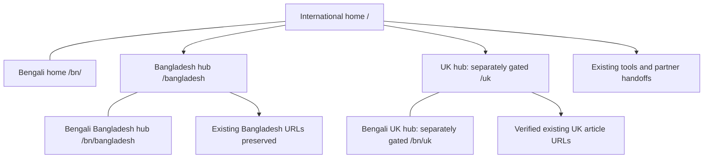

# URAL — International Expansion, Preserved Bangladesh Expertise

**Lifecycle:** corrected design proposal, awaiting owner review. **Date:** 22 November 2026.
**Authority:** the owner requested a detailed cross-tool plan, not application edits, publication or deployment.

**Later handoff update, corrected 22 November:** the owner authorised publishing the documents and
clarified that the AI which supplied the review owns implementation **and approved research/content
writing**. The earlier instruction to leave writing to a separate tool is withdrawn. The prompt
scopes an initial engineering batch and A-D plan-contract corrections; it does not waive article
scope, source, publication or UI-deployment gates. Fetched upstream `f782dd7` contains the approved navigation, so any old
missing-navigation observation belongs to the earlier stale checkout.

## 1. Intent and confirmed direction

Make URAL's front door useful to international travellers; develop the UK as a focused growth market;
preserve Bangladesh-specific expertise and every existing public URL. Pursue useful traffic and first
attributable revenue together, without assuming that a redesign produces either.

The owner selected Option B: an international homepage plus a dedicated Bangladesh doorway. The
subsequent review withdrew inaccurate SEO, visa, traffic and build claims. This proposal incorporates
those corrections. It does not automatically supersede `PRODUCT.md`, `AGENTS.md` or the approved
19 November navigation design. Update durable direction documents only after explicit approval.

## 2. Approaches considered

| Approach | Trade-off | Decision |
|---|---|---|
| Replace Bangladesh content with UK content; rename routes; default every search to London | Large editorial risk, loses specificity, assumes unverified demand | Rejected |
| One homepage whose content changes by inferred geography | Less visible structure, unreliable location inference, crawl and consent complexity | Not selected |
| International home plus Bangladesh hub; retain existing deep pages | Additive, understandable, preserves investments, requires explicit locale and discovery work | Owner selected this direction |
| UK-only homepage plus a UK hub immediately | Narrows the audience and expands scope beyond Option B | Not the base release; UK hub has a later approval gate |

Keep the existing brand, stack and domain. No new comparison engine, booking operation, paid travel
desk, language, IP detection service, account system or pricing database is part of this design.

## 3. Corrections every executor must preserve

1. `.co.uk` remains a strong UK-associated domain signal. Bangladesh impressions demonstrate that
   Bangladesh visibility is possible, not that the domain is neutral. No migration is proposed.
2. Google identifies language from visible content. `<html lang>` supports accurate language and
   accessibility; it is not a ranking switch. `hreflang` selects appropriate equivalent versions;
   `x-default` supplies a fallback, not a way to neutralise a ccTLD.
3. Different planning hubs are not automatically alternate versions of one page. Link them through
   navigation. Use hreflang only between genuinely equivalent translated/regional pages.
4. The 22–31 October GSC sample is historical and small. The correction at the top of
   `docs/03-social/GSC-READ-2026-11-02.md` withdraws the diagnosis that zero clicks proves bad titles.
   Do not prescribe bulk rewrites or infer no backlinks, low demand, or a guaranteed earning window.
5. `sid=uk` in `src/data/evisaProgram.ts` was observed on 22 November to open UK ETA assistance for
   eligible visitors **entering the UK**. It is not a campaign for British citizens travelling abroad.
   Recheck eligibility and provider routing before promotion; attribution requires account evidence.
6. British citizen tourist travel to Turkey is visa-exempt within the official conditions observed
   on 22 November. Do not commission an unnecessary paid eVisa funnel. Recheck before publication.
7. `/api/rates` returns dated FX data, not location. Departure selection, nationality and residence
   are three separate inputs; language and currency do not prove any of them.
8. A click, an enquiry attempt, an approved commission and a payout are different outcomes.

Primary references checked during the preceding review:
- https://developers.google.com/search/docs/specialty/international/managing-multi-regional-sites
- https://developers.google.com/search/docs/specialty/international/localized-versions
- https://www.gov.uk/foreign-travel-advice/turkey/entry-requirements
- Owner-supplied UK eVisas campaign in `src/data/evisaProgram.ts` (provider observation, not government eligibility evidence).

## 4. Scope and proposal defaults to approve

| Scope | Proposed choice | Approval consequence |
|---|---|---|
| Base homepage | `/` becomes international; `/bn/` expresses the same decisions naturally in Bengali | Includes Bengali homepage changes, not a silent English-only pivot |
| Bangladesh hub | `/bangladesh` and `/bn/bangladesh`, authored together | Two new public URLs; preserve all existing Bangladesh pages |
| UK hub | `/uk` and `/bn/uk`, only after separate scope approval and useful verified membership | Optional second release; not inferred from Option B |
| Homepage search | Empty origin and destination in both languages; USD until an origin/currency is selected | No IP/browser-language detection and no compulsory London default |
| Bangladesh search | DAC origin and BDT display; destination unselected | Useful Bangladesh default, never locked; existing deep-page defaults stay |
| Selected UK airport | GBP until the reader manually selects another currency | Extend origin policy, never invent an FX conversion |
| Old article metadata | Preserve audience-specific titles, bodies and regional language labels | No global search-and-replace of `en-BD` or "from Bangladesh" |
| Menu | Add published hub links within existing Guides & Tools groups, footer and homepage | Preserve seven-item primary row and approved visual identity |

If the owner does not approve a proposed choice, stop the affected release and revise that bounded
choice. Do not construct an unauthorised Bengali fallback or assume `/uk` publication approval.

## 5. Page and relationship map

```text
/  International home                 <-> /bn/ Bengali equivalent
|-- /bangladesh  Bangladesh departures <-> /bn/bangladesh
|   |-- /flights and existing dhaka-* routes (same URLs)
|   |-- /visa and /visa-free-countries (Bangladesh-specific collections)
|   |-- /costs, /banking, /pre-departure (existing scope)
|   `-- existing Bangladesh and Umrah articles
|-- /uk  UK departures [later gate]    <-> /bn/uk
|   `-- verified UK Umrah and other published guides (same URLs)
|-- /visa-assistance (private service clearly explained)
|-- /destinations, /hotels, /experiences, /attractions
`-- /blog, /tools, /about, /partners, /resources, /contact
```



| Page | English language / hreflang | BN language / hreflang | Open Graph locale | Relationship |
|---|---|---|---|---|
| International home | `en` | `bn-BD` | `en_GB` / `bn_BD` | `/` and `/bn/`; x-default `/` |
| Bangladesh hub | `en-BD` | `bn-BD` | `en_BD` / `bn_BD` | `/bangladesh` and `/bn/bangladesh`; x-default English hub |
| UK hub, if approved | `en-GB` | `bn-BD` | `en_GB` / `bn_BD` | `/uk` and `/bn/uk`; x-default English hub |
| Other existing routes | Existing labels preserved in this release | Existing labels preserved | Existing valid values preserved | Existing counterpart only |

All members of each real pair emit the same reciprocal annotations in head and sitemap. No alternate
from a deep article to a regional home. Every public page keeps its own self-canonical. Keep valid
Open Graph `language_TERRITORY` syntax; never write `og:locale="en"`.

`Language` stays `"en" | "bn"`. Add a tiny explicit profile for the touched paths, not a third UI
locale. Both saved HTML and client navigation must derive language, hreflang and OG values from it.

## 6. What readers see

Keep "Plan Your Trip / From Anywhere"; it already exists. Complete that promise rather than
rebuilding the hero. Proposed English subtitle: "Source-backed travel guides, global flight search
and practical next steps for your passport and departure." Bengali carries the full same meaning.

The international homepage retains flight search, hotel handoffs, eVisas, destinations, Umrah, tools
and newsletter. Change exclusive Bangladesh framing in its intro, feature pills, directory headings
and support labels. Replace unsupported fixed stats with descriptive capabilities. Include a clear
Bangladesh planning doorway; add the UK doorway only when its hub is actually publishable.

Homepage FAQs are part of that paired scope, not an English-only exception. Replace the four
Bangladesh-only homepage questions with four non-price orientation questions: URAL's editorial/not-
seller role, where to check passport/residence entry rules, how display currency is chosen, and where
to find Bangladesh-specific guidance. Author natural EN/BN versions in `src/data/homeFaqs.ts`; visible
answers and FAQ schema consume the same localized records. Do not transplant old unsupported money
estimates into the Bangladesh hub or keep an English-only FAQ/schema gate on `/bn/`.

Scope-specific links remain truthful: "Dhaka route guides", "Bangladesh passport checklists" and
"Budgets entered in BDT" must not become universal claims. Destination cards retain the guide's
real audience. Country-of-destination and country-of-departure are not the same catalogue dimension.

Bangladesh hub job: help a reader choose the next existing guide. Group flights, visas, money,
pre-departure and pilgrimage guidance; explain nationality-dependent exceptions. No copied full
articles, speculative costs or mandatory search widget. Shared global search can be reached through
an explicit DAC default on Bangladesh surfaces.

UK hub job, if approved: organize verified travel-from-UK decisions, starting with actual existing
UK Umrah material. "Visiting the UK" is a separately labelled link, not the hub's passport premise.

Header additions belong within Guides & Tools; footer additions belong within planning resources.
No eighth primary item, new fixed row, flag-only label or redesigned menu. Logo/Home remains `/` or
`/bn/` by language; language switching stays within the current page's real pair.

## 7. Search, tools and money

Empty airport state is real: cannot silently become DAC/KTM or a fabricated three-letter airport.
Existing `findAirportInfo` returns the first directory entry for empty input, so changing only the
homepage prop is insufficient. Use a nullable selected-airport state and validate before handoff.

Default currency policy: current Bangladesh codes -> BDT; explicitly mapped UK codes -> GBP;
other/unknown/empty -> USD. Manual currency choice wins after origin changes and swaps. Keep provider
locale `en` / `bn`, Page 24232, native flightSearch encoding, safe links and existing legacy redirects.

No new rates implementation is required. `src/utils/rates.ts` and `rateData.ts` already implement
dated references and bounded cache; verify fresh, labelled-stale and expired/missing cases. BDT-input
worksheets keep their input unit. Do not convert a supplier quote into a "Western spending" model.

## 8. Traffic and commercial programme

Start readiness and distribution alongside foundation work; neither waits for a full UK expansion.
Do not run concurrent agents on shared files (`App.tsx`, `prerender.ts`, constants, Bengali metadata).

Maintain four bounded content pillars:
1. Bangladesh outbound constraints — preserve and distribute useful existing assets.
2. UK DIY Umrah — audit existing corpus and real gaps before new articles.
3. Entry/application decisions — passport + residence + destination, official route first, optional
   paid help only when eligible and verified; keep inbound UK ETA distinct from UK outbound visas.
4. In-destination logistics and disruption — existing relevant guides/tools, source-reviewed before promotion.

Candidate work is a hypothesis until evidence exists. No fixed country list, fabricated search
volume, unconditional UK261/ATOL eligibility, low-competition claim or earnings forecast. Prefer one
complete decision journey over many generic international articles. Reuse existing URLs owning the job.

Commercial path: useful answer -> qualified disclosed partner action -> supported partner reporting.
Track organic and distribution sources separately; no invented SubIDs or conversion callbacks.
Keep the free WhatsApp desk and newsletter's real opt-in process. Operator lead fees, paid advice,
insurance programme changes, packages and paid acquisition each require separate owner approval.

WhatsApp purpose tagging includes production anchors, not only a synthetic tracking test. Mark desk
contacts and article-sharing anchors distinctly in App, the blog view, support and inquiry components;
test their rendered markers before trusting aggregate enquiry figures. Unknown legacy placements
stay unknown, and no prefilled message or freeform note is sent to analytics.

Prepare each approved landing asset plus two useful adaptations, one owned-channel draft and a
small relevant earned-link outreach list. Publishing, sending and posting require operational approval.
No spam, bought links, fabricated firsthand experience or claim of reach from a drafted campaign.

## 9. Invariants and stopping conditions

- Existing canonical path set preserved, including old dated slugs. No new redirects or domain change.
- Bengali decision-level parity, explicit locale links, truthful dates and sources.
- Every published money figure has date and source; no fixed FX constant introduced.
- Central consent; no ungated third-party embeds or direct optional-storage bypass.
- Registry-based affiliate lifecycle; preserve supplied eVisas campaigns and exclusions.
- No fabricated reviews, expertise, operating address, savings, schedules, live availability or booking role.
- No new dependency, CMS migration, account system, bot, additional language or performance-budget increase.
- Tests: lint, build, verify:build and touched suites exit 0; static and browser proof both required.
- Baseline defects are recorded and separately scoped, never silently repaired or hidden by weaker tests.
- Builds/scheduling can generate unrelated due content: reconcile it before release; no implicit publication.
- Use isolated work for future implementation; no commit/push/PR/merge/deploy permission from this document.

## 10. Success and review

Engineering acceptance is deterministic: correct pages/links, preserved routes, accurate handoffs,
language/static-client parity, consent and build proof. Search and commercial outcomes are observations,
not release pass/fail promises.

Report GSC property, dates, country, query, landing page and device. Report sessions, qualified partner
clicks, confirmed enquiries, transactions if exposed, approved commissions and payouts separately.
Missing account access is "unverified", not zero. Use approved commission per qualified partner click
only when source and denominator are comparable. Do not apply profit-share to gross booking value.

Review engineering immediately after release; reader feedback weekly; comparable search and commercial
windows at 30/60/90 days from actual release. Small samples do not establish success/failure. Continue,
repair or broaden only on scoped evidence; do not repeatedly redesign the homepage.

## 11. Plan set and approvals

Start with `docs/superpowers/plans/2026-11-22-international-expansion-master.md`.
Companion plans separate readiness, foundation and growth/pilot work. A fresh builder check evaluates
clarity, not factual certification or owner approval. Proposed choices in section 4 and the first
release must be approved before application implementation. Optional `/uk`, content pilots, outbound
communications, account settings and production deployment have their own listed gates.
